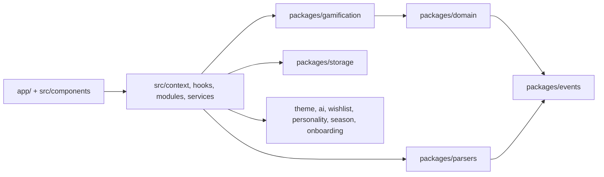
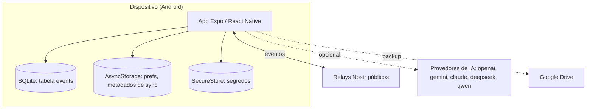
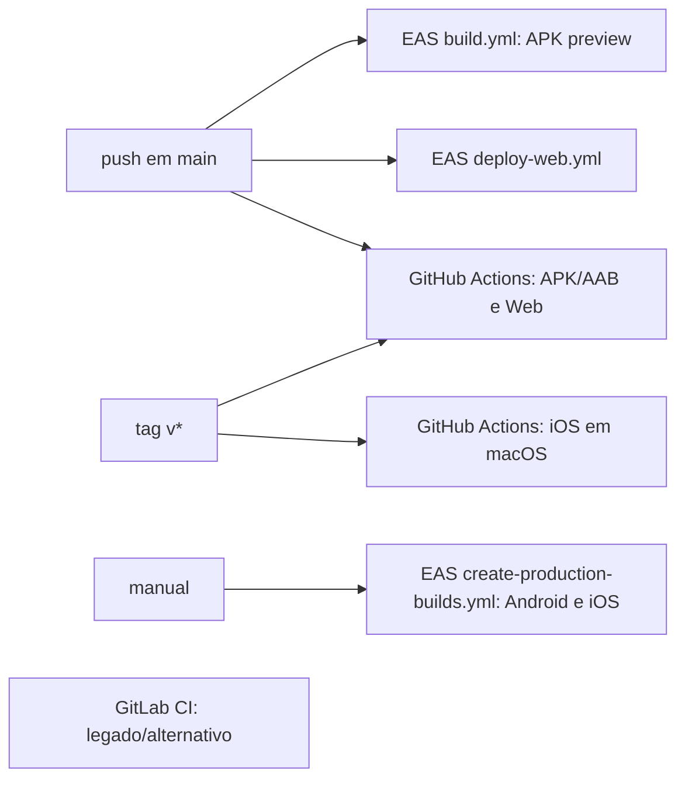

# Architecture Spine — DOMUS

## Design Paradigm

**Event Sourcing offline-first, com Functional Core / Imperative Shell.** O estado do app nunca é persistido: é sempre o replay do log de eventos por reducers puros. O núcleo (`packages/*`) é funcional e sem plataforma; a casca (`app/`, `src/`) faz IO, relógio, UI, efeitos e sync.

| Camada | Onde | Papel |
| --- | --- | --- |
| Núcleo funcional | `packages/*` | tipos de evento, reducers puros, engines (XP, streak, tema), parsers |
| Persistência | `packages/storage` | dona do SQLite (tabela `events`) no nativo |
| Casca | `src/context`, `src/hooks`, `src/modules`, `src/services` | `AppStateProvider`, efeitos, sync Nostr, IA, backup, segurança |
| UI | `app/` (Expo Router), `src/components` | telas; despacham eventos, nunca mutam estado |

## Invariants & Rules



Setas = "pode depender de". Nada em `packages/*` aponta para `app/` ou `src/`.

### AD-1 — Estado é replay de eventos [ADOPTED]

- **Binds:** all
- **Prevents:** telas ou hooks persistindo estado derivado ou mutando estado direto, gerando duas fontes de verdade; e dois caminhos de escrita usados ao acaso.
- **Rule:** o único caminho de mudança de estado é evento → log → replay. Não persista estado derivado (saldo, XP total, total de conquistas); recalcule do log. Existem dois despachos: `dispatch` só grava o evento; `dispatchDomainEvent` grava e dispara os efeitos de gamificação. Evento de domínio usa `dispatchDomainEvent`; os demais usam `dispatch`. Exceção conhecida: `LEVEL_UP` e `STREAK_UPDATED` gravam valor absoluto (ver Deferred).

### AD-2 — Log append-only, imutável, idempotente, em ordem total [ADOPTED]

- **Binds:** `packages/events`, `packages/storage`, sync
- **Prevents:** duas versões divergentes do mesmo fato após sync, reescrita de histórico e replay diferente entre aparelhos.
- **Rule:** um evento nunca é editado nem apagado do log; correção é um novo evento (`*_UPDATED`, `*_DELETED`). Envelope fixo `{id, type, payload, timestamp, deviceId, signature}`. Inserção idempotente por `id` (`INSERT OR IGNORE`). O evento não é assinado: `signature` fica vazia por compatibilidade e a confiança vem da chave do grupo de sync. O replay usa ordem total `(timestamp, deviceId, id)`, no SQLite e em memória. O código atual ordena só por `timestamp`; alinhar é dívida registrada.

### AD-3 — Núcleo puro e direção de dependência [ADOPTED]

- **Binds:** `packages/*`
- **Prevents:** reducers ou engines acoplados a plataforma, relógio ou aleatoriedade, quebrando o replay determinístico.
- **Rule:** `packages/*` nunca importam `react`, `react-native` nem `expo`. Reducers e engines de replay são puros: sem `Date.now`, `Math.random`, IO. O gerador de id é `generateId` de `packages/events/src/factory.ts`, chamado por `createEvent` ao criar o evento; não crie outro gerador. As cópias em `packages/core` e em `packages/parsers` (`sefazParser.ts`, `ocrParser.ts`) são dívida. Respeite o diagrama: `gamification → domain → events` e `parsers → events`.

### AD-4 — Registro e roteamento de tipos de evento

- **Binds:** `packages/*/src/types.ts`, `src/context/AppStateProvider.tsx`
- **Prevents:** evento novo ignorado em silêncio no replay.
- **Rule:** cada package dono declara seus tipos em `*_EVENTS` (UPPER_SNAKE). Todo tipo novo precisa ser roteado a um reducer em `replayAllEvents` (`AppStateProvider`); tipo não roteado é descartado. Namespaces de tipo não se sobrepõem. Casos que já violam: `PERSONALITY_EVENTS` não é roteado, e `packages/parsers/src/types.ts` define um segundo `EVENT_TYPES`, também sem rota (ver Deferred).

### AD-5 — Efeitos derivados viram eventos na casca [ADOPTED]

- **Binds:** `src/hooks/useGamificationEffects.ts`, `packages/gamification`
- **Prevents:** XP, conquistas e troféus calculados dentro de reducers.
- **Rule:** engines (XP, streak, conquistas, troféus) calculam em `packages/gamification` e a casca emite o resultado como evento. Reducer só dobra eventos; nunca decide "ganhou conquista".

### AD-6 — Onde mora cada tipo de estado [ADOPTED]

- **Binds:** `src/**`
- **Prevents:** o mesmo dado em evento e em AsyncStorage, e segredos em armazenamento sem proteção.
- **Rule:** fatos (financeiro, gamificação, missões, season, wishlist) são eventos. Preferências de UI e metadados de sync ficam em `AsyncStorage`. Chaves de API, PIN e segredos ficam só em `expo-secure-store`. Nenhum segredo novo em `AsyncStorage`, em evento ou em variável `EXPO_PUBLIC_*` (vai embutida no bundle).
- **Como se cumpre hoje:** o group code do sync fica em `SecureStore` (`loadGroupCode`/`saveGroupCode` em `src/context/syncStorage.ts`, com migração do valor legado). O backup do Drive no nativo usa `GoogleSignin.getTokens()` (`src/modules/backup/infrastructure/GoogleNativeAuth.ts`); não há `client_secret` no app.
- **Verificado por máquina:** o ESLint (`no-restricted-syntax` em `eslint.config.js`) barra `process.env.EXPO_PUBLIC_*` com `SECRET`, `PRIVATE` ou `PASSWORD` no nome. O resto da regra segue só por revisão.
- **Web:** não há `SecureStore`; segredos (group code, tokens do Drive) passam por `webSecrets` (`src/modules/security/infrastructure/webSecrets.ts`): AES-GCM com chave não extraível no IndexedDB, ciphertext no `AsyncStorage`. Sem WebCrypto ou IndexedDB o segredo fica só em memória, nunca em texto puro. Não protege de XSS. Segredo novo na web usa `webSecrets`, nunca `AsyncStorage` direto.
- **Exceções atuais (dívida):** (1) na web não há SQLite; o log inteiro (`domus_events_v1`) fica em `AsyncStorage` sem cifra; eventos não são segredo, mas contêm dados financeiros. (2) No nativo, se o `SecureStore` falhar ao gravar o group code, `saveGroupCode` cai para `AsyncStorage` com um `console.warn`; é queda silenciosa de segurança, aceita para não perder o sync.

### AD-7 — Dinheiro é `number` em reais

- **Binds:** `packages/events`, `packages/domain`, UI
- **Prevents:** duas telas arredondando de forma diferente e saldos que não fecham.
- **Rule:** valor monetário é `number` em reais, arredondado a 2 casas ao criar o evento. Exibição só via `formatCurrency` (`src/utils/formatCurrency.ts`, `pt-BR`/BRL). Centavos inteiros ficam Deferred.

### AD-8 — Sync é troca do log, sem servidor próprio

- **Binds:** `src/modules/nostrSync.ts`, `src/context/useSyncEngine.ts`, `src/context/SyncProvider.tsx`
- **Prevents:** resolver conflito por sobrescrita e criar backend de sync.
- **Rule:** sync publica e importa eventos via relays Nostr públicos; o merge é a união por `id` seguida de replay na ordem do AD-2. Não há resolução de conflito por sobrescrita. O `server/` Express não participa do sync. A cifra XOR do sync não é criptografia forte.

### AD-9 — Congelados e legado [ADOPTED]

- **Binds:** `packages/sync`, `packages/core`, `replit.md`, `replit.nix`, `.replit`
- **Prevents:** agentes evoluindo código morto ou mexendo no que o dono vai reaproveitar.
- **Rule:** `packages/sync` (WebRTC legado) é congelado; só `src/services/webrtcFactory.ts` importa tipos dele. `packages/core` é legado: código novo usa `packages/domain`. `replit.md`, `replit.nix` e `.replit` são intocáveis.

### AD-10 — Troféus são colecionáveis únicos por pessoa

- **Binds:** `packages/gamification`, `src/hooks/useGamificationEffects.ts`
- **Prevents:** cada aparelho da mesma pessoa sorteando um troféu diferente e pagando XP em dobro.
- **Rule:** o sorteio é aleatório de propósito, como um pacote de figurinhas, e vale por pessoa, não por aparelho. O resultado é gravado como evento (`SEASONAL_TROPHY_SELECTED`) e um aparelho só sorteia se não houver seleção daquele período no log. Receber o mesmo troféu em outro ano sobe o nível (tier) dele, não duplica. Hoje a semente é o `deviceId` (`pickSeasonalTrophy`), então o código ainda não cumpre; é dívida registrada.

### AD-11 — Pipelines de build e release

- **Binds:** `.eas/workflows`, `.github/workflows`, `.gitlab-ci.yml`, `eas.json`
- **Prevents:** três pipelines produzindo artefatos diferentes sem um dono.
- **Rule:** os pipelines canônicos são EAS e GitHub Actions. O GitLab CI é legado/alternativo; não o evolua. Mudança de build, assinatura ou versão vai nos canônicos.

## Consistency Conventions

| Concern | Convention |
| --- | --- |
| Naming (entities, files, interfaces, events) | Tipos de evento em UPPER_SNAKE dentro de `*_EVENTS`; cada package tem `index.ts`, `src/` e `__tests__/`; aliases `@/*`, `@packages/*`, `@shared/*` |
| Data & formats (ids, dates, error shapes, envelopes) | `id` via `generateId()` de `packages/events` (AD-3); `timestamp` em ms epoch; dia civil como `YYYY-MM-DD` local; valor em reais com 2 casas |
| State & cross-cutting (mutation, errors, logging, config, auth) | Mutação só por evento (AD-1); telas usam `useAppState()`; texto de UI em pt-BR com acentos completos; segredos só em SecureStore (AD-6) |

## Stack

| Name | Version |
| --- | --- |
| Expo SDK (fixado em 54) | ~54.0.33 |
| React Native (Nova Arquitetura ligada) | 0.81.5 |
| React (React Compiler ligado) | 19.1.0 |
| TypeScript (strict) | ~5.9.2 |
| Expo Router | ~6.0.23 |
| expo-sqlite | ^16.0.10 |
| nostr-tools | ^2.23.1 |
| Vitest | ^4.0.18 |
| Tamagui (pré-release RC) | ^2.0.0-rc.26 |
| react-native-reanimated / worklets | ~4.1.1 / 0.5.1 |
| Firebase (app, analytics, crashlytics, perf) | ^23.8.6 |
| Express + drizzle-orm + pg (server) | ^5.0.1 / ^0.39.3 / ^8.18.0 |
| Node (CI) | 20 |

## Structural Seed





```text
{root}/
  app/        # telas (Expo Router)
  src/        # casca: context, hooks, modules, services, components
  packages/   # núcleo funcional, um package por domínio
  server/     # Express: build estático e landing page
  plugins/    # config plugins nativos
  patches/    # patch-package (aplicado no postinstall)
  docs/       # documentação e histórico
```

`ios/` e `android/` são gerados por `expo prebuild --clean` e não vão ao git.

## Deferred

Riscos abertos, cada um com gatilho:

- **Login do Drive no nativo sem segredo:** o fluxo novo (`getTokens()`) não foi testado em aparelho; o usuário precisa reconectar o Drive uma vez. Verificar em Android real antes do próximo release. O client secret antigo já foi publicado em builds anteriores: rotacionar no Google Cloud Console.
- **Gamificação com vários aparelhos no mesmo grupo:** `LEVEL_UP` e `STREAK_UPDATED` gravam valor absoluto (vence o último a chegar); `ACHIEVEMENT_UNLOCKED` soma XP sem dedupe; o aporte pendente (`useSavingsGoalScheduler`), a recuperação de XP e as categorias padrão são gerados por aparelho com ids aleatórios. Revisitar antes de promover sync entre aparelhos.
- **Replay frágil:** `replayAllEvents` roda sem `try/catch` dentro de `useMemo`; um payload malformado derruba o app a cada boot. Revisitar antes de abrir o sync a mais usuários.
- **Push do sync:** `publishSyncEvents` engole a falha de cada lote e o lote não é reenviado; o pull tem `limit: 500` sem paginação. Revisitar junto com o item anterior.
- **Roteamento de eventos:** decidir se `PERSONALITY_EVENTS` e o `EVENT_TYPES` de `packages/parsers` são roteados ou removidos; renomear o enum de parsers.
- **Versão do payload do evento:** o envelope não tem versão; revisitar antes da primeira mudança de formato de um payload existente.
- **Centavos inteiros** para dinheiro: migrar eventos já publicados é caro; revisitar se surgir erro de arredondamento.
- **Assinatura de eventos** e cifra real no sync (hoje XOR): revisitar antes de qualquer dado sensível extra no log.
- **Remoção de `packages/core`** e do `SyncEvent` duplicado em `packages/storage` e `packages/sync`.
- **Expo SDK 54 e Tamagui RC:** sem política de upgrade; revisitar quando uma exigência da Play Store ou um patch de plataforma pedir. Reavaliar `patches/` e `newArchEnabled` nesse momento.
- **Dois caminhos de web:** EAS `deploy-web` e o job web do GitHub Actions; decidir qual é o canônico.
- **Operação e infra:** onde o `server/` roda em produção, observabilidade (só Analytics é importado em `src/`; Crashlytics e Performance estão instalados) e backup do banco do `server/` (`drizzle`/`pg`, sem rotas ativas). Aberto.
- **Qualidade:** não há script `test` nem `typecheck` no `package.json`, e o ESLint ignora `packages/*`; os limites dos AD-3 e AD-4 ficam sem verificação automática.
- **Planejamento:** migra de `ROADMAP.md` para `_bmad-output/planning-artifacts/`.
